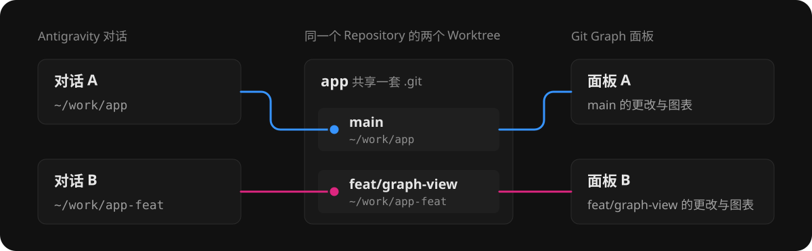
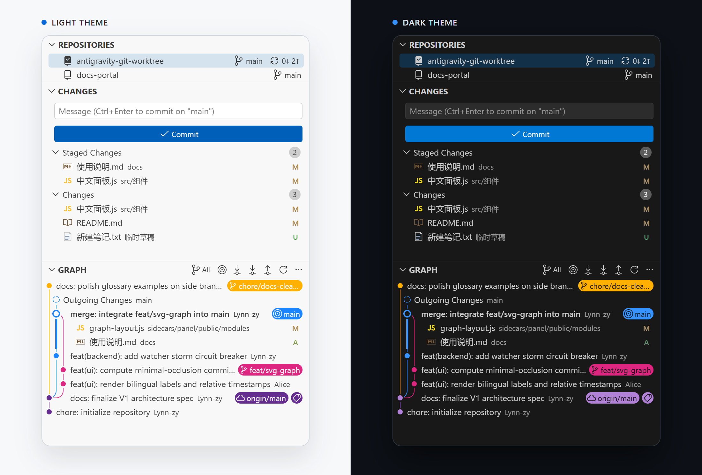

<p align="center">
  
</p>

<p align="center">
  Antigravity 2.0 桌面端插件 · 无需构建 · 无运行时依赖 · Node.js ≥ 20
</p>

<p align="center">
  
</p>

## 这是什么

Git Graph（插件标识 `antigravity-git-worktree`）是 Antigravity 2.0 桌面端的 Sidecar 插件。它在右侧辅助栏（Auxiliary Pane）放一个 VS Code 风格的源代码管理视图。上半区「更改」用来暂存和提交，下半区「图表」显示提交历史。

面板里没有选仓库的步骤。当前对话打开了哪个目录，面板就显示这个目录所在的 Worktree。

## 跟着对话切换 Worktree

<p align="center">
  
</p>

同时开几个 Agent、每个 Agent 在自己的 Worktree 上改代码时，切到哪个对话，面板就显示哪个 Worktree 的更改和图表。

- 插件监听宿主的 `workspace-change` 事件，用 `git rev-parse --git-common-dir` 把同一仓库的多个 Worktree 归为一个 Repository，再按目录找到当前 Worktree。
- `.git` 和工作区文件变化时面板自动刷新。在终端里执行 Git 命令，面板也会同步。
- 一个对话同时打开多个仓库时，顶部出现一行仓库切换条。只有一个仓库时这一行不占高度。

## 功能

**更改（上半区）**

- 输入提交说明后按 `Ctrl/Cmd + Enter` 提交。
- 主按钮随状态变化。有已暂存的更改时直接提交；只有未暂存的更改时，确认后暂存全部再提交；工作区干净时，按与上游的差异切换为推送、发布分支或拉取。
- 按分组暂存或取消暂存。放弃更改和永久删除未跟踪文件之前都会弹窗确认。
- 文件多时只滚动文件列表，提交输入框固定在上方。列表超过 500 行时只渲染可视区附近的行；变更超过 5000 条时只显示前 5000 条，文件改动触发的刷新至少间隔 15 秒。

**图表（下半区）**

- 「自动」只显示当前分支及其上游，「全部」显示所有分支与标签。泳道算法移植自 VS Code，泳道颜色和引用徽标与 VS Code 一致。
- 顶栏按钮依次是转到当前提交、提取（`git fetch --all --prune`）、拉取（`git pull --ff-only`）、推送和刷新。`⋯` 菜单里可以打开提交搜索、折叠全部已展开的提交、切换中英文界面。
- 点击提交行，在原地展开它改动的文件。点击行尾按钮打开提交详情卡，里面有作者与日期、按 Markdown 渲染的提交说明、改动文件数与增删行数、引用和可复制的完整 SHA。

**打开文件**

- 点击更改列表或提交里的文件，插件调用宿主自带的 `fileView` 在辅助栏打开它。插件本身不带 Diff 查看器。
- 文件图标来自 vscode-icons，未跟踪的目录显示对应的文件夹图标。

## 明暗主题

<p align="center">
  
</p>

面板的颜色来自宿主注入的 CSS 变量。宿主切换浅色、深色或高对比度主题时，面板跟着切换。成功、警告、错误三种状态色会校正到与背景至少 4.5:1 的对比度。面板宽度在 320–560px 之间时不会出现横向滚动条。

## 安装

需要 Node.js 20 或更高版本，以及 `PATH` 中可用的 `git`。

```powershell
# Windows（PowerShell）
powershell -ExecutionPolicy Bypass -File .\scripts\install.ps1
```

```bash
# macOS / Linux
bash ./scripts/install.sh
```

然后打开 Antigravity 的 Customizations 页面，启用 **Git Graph**。

安装脚本只把 `plugin.json`、`assets/` 和 `sidecars/panel/` 复制到 `~/.gemini/config/plugins/antigravity-git-worktree`，不修改 `~/.gemini/config/config.json`。

| 用途 | Windows | macOS / Linux |
| --- | --- | --- |
| 拷贝安装或更新（默认） | `install.ps1` | `install.sh` |
| 开发时让安装目录直接指向源码 | `install.ps1 -Link`（Junction，不需要管理员权限） | `install.sh --link`（符号链接） |
| 卸载，只删除安装目录或链接本身 | `install.ps1 -Uninstall` | `install.sh --uninstall` |

## 在浏览器里预览

不打开 Antigravity 也能运行面板。没有宿主注入的环境变量 `ANTIGRAVITY_SIDECAR_WEB_PORT` 时，`main.mjs` 在 `127.0.0.1:17892` 启动一个本地 HTTP 服务：

```bash
# 显示当前仓库，或传入一个或多个目录
node sidecars/panel/main.mjs
node sidecars/panel/main.mjs /path/to/repo-a /path/to/repo-b
```

打开 <http://127.0.0.1:17892/?fixture=mock&theme=dark> 可以看到内置的演示数据，本页的截图都来自这个模式。

| URL 参数 | 作用 |
| --- | --- |
| `fixture=mock` | 使用内存中的演示数据，可以完整走一遍暂存、提交、推送 |
| `theme=dark`、`theme=light` | 指定明暗主题 |
| `sdk=1` | 注入模拟的 `window.sidecar`，用来调试 `theme-change` 与 `workspace-change` 消息 |

| 环境变量 | 作用 |
| --- | --- |
| `AG_GIT_PORT` | 端口，默认 `17892` |
| `AG_GIT_PATHS` | 要显示的目录。Windows 用分号分隔，macOS / Linux 用冒号分隔 |

## 不做的事

为了让窄幅辅助栏保持简单，当前版本不包含下面这些能力（完整列表见 [docs/spec.md](./docs/spec.md#13-明确不在-v1-范围)）：

- 新建、锁定、删除 Worktree，以及切换分支。Worktree 和对话的切换由宿主负责。
- 插件内的 Diff 查看器。
- 行级或 Hunk 级暂存、Stash、Rebase、`--amend` 和 Force Push。
- 通过 CDP 或其他非公开通道修改宿主界面。插件只使用官方 Sidecar 接口（见 [ADR 0001](./docs/adr/0001-pure-official-sidecar-and-scope-focus.md)）。

## 开发

<details>
<summary>运行测试</summary>

全部测试使用 Node.js 内置的 `node:test`，不需要 `npm install`。浏览器端到端测试需要 Node.js 22 以上（使用内置的 `WebSocket` 与 `fetch`），以及本机安装的 Microsoft Edge 或 Google Chrome。

```bash
# 单元测试、后端集成测试与无头浏览器端到端测试
node --test tests/unit/*.test.mjs tests/integration/*.test.mjs tests/browser/*.test.mjs

# 分层运行
node --test tests/unit/*.test.mjs
node --test tests/integration/*.test.mjs
node --test tests/browser/m5-e2e-browser.test.mjs
```

浏览器不在默认安装路径时，用环境变量 `AG_BROWSER_PATH` 指定 `msedge.exe` 或 `chrome` 的路径。

</details>

<details>
<summary>重新生成图标数据</summary>

`codicons.js`、`file-icon-map.js` 和 `file-icons/` 下的 SVG 都由脚本从固定提交的上游仓库生成，不要手工编辑。升级上游时，修改脚本顶部的提交 SHA 后重新运行，再检查 `git diff`。

```bash
# 需要 Node.js 22.18+、git、tar，以及能访问 GitHub 的网络
node scripts/gen-codicons.mjs
node scripts/gen-file-icons.mjs
```

</details>

- 架构规格与 V1 验收标准：[docs/spec.md](./docs/spec.md)
- 领域术语：[GLOSSARY.md](./GLOSSARY.md)
- 架构决策记录：[docs/adr/](./docs/adr/)
- 协作约定：[AGENTS.md](./AGENTS.md)

## 第三方声明

泳道算法移植自 Visual Studio Code，图标来自 VS Code Codicons 和 vscode-icons。各自的许可证见 [THIRD_PARTY_NOTICES.md](./THIRD_PARTY_NOTICES.md)。
