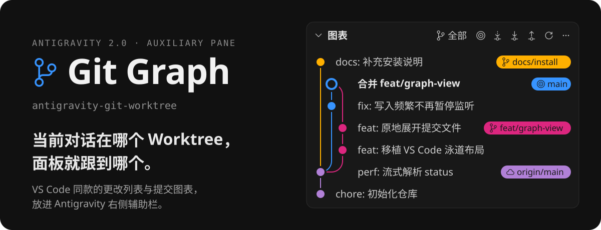
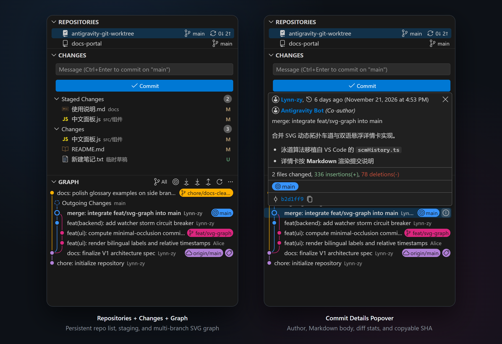

<div align="center">

<h1>Git Graph</h1>

<p>
  <strong>VS Code-style Source Control and inline SVG Commit Graph in the Antigravity 2.0 Auxiliary Pane.</strong><br/>
  Automatically follows the active conversation Worktree — zero build step, zero runtime dependencies.
</p>

<p>
  <strong>English</strong> · <a href="./README.zh-CN.md">简体中文</a>
</p>

<p>
  <a href="./plugin.json"></a>
  <a href="./sidecars/panel/package.json"></a>
  <a href="./docs/adr/0002-zero-build-esm-and-svg-graph.md"></a>
  <a href="./LICENSE"></a>
</p>



</div>

## Quick Start

**Prerequisites:** Node.js `>= 20` and `git` available in `PATH`.

Clone the repository and run the platform install script:

```powershell
# Windows (PowerShell)
git clone https://github.com/Lynn-zy/antigravity-git-worktree.git
cd antigravity-git-worktree
powershell -ExecutionPolicy Bypass -File .\scripts\install.ps1
```

```bash
# macOS / Linux
git clone https://github.com/Lynn-zy/antigravity-git-worktree.git
cd antigravity-git-worktree
bash ./scripts/install.sh
```

The installer prints the target path (`~/.gemini/config/plugins/antigravity-git-worktree`) and does not touch `~/.gemini/config/config.json`. Open **Customizations** in Antigravity and enable **Git Graph**. When updating or uninstalling an already running instance, the installer reads `.sidecar.pid` and restarts or stops the running sidecar automatically.

**Want to try the UI in a browser first?** Run Standalone mode without opening Antigravity:

```bash
node sidecars/panel/main.mjs
# [antigravity-git-worktree] Standalone server listening at http://127.0.0.1:17892
```

Open <http://127.0.0.1:17892/> to inspect the current repository, or <http://127.0.0.1:17892/?fixture=mock&theme=dark> to try built-in mock repositories in memory (staging, committing, and graph inspection all work offline).

<details>
<summary>Install script options (copy, symlink/junction for development, uninstall)</summary>

| Action | Windows | macOS / Linux |
| --- | --- | --- |
| Install or update runtime files (`plugin.json`, `assets/`, `sidecars/panel/`) | `.\scripts\install.ps1` | `bash ./scripts/install.sh` |
| Link source repo for live development | `.\scripts\install.ps1 -Link` (NTFS Junction, no admin required) | `bash ./scripts/install.sh --link` (symlink) |
| Custom install directory | `.\scripts\install.ps1 -TargetDir <dir>` | `bash ./scripts/install.sh --target-dir <dir>` |
| Uninstall (removes install directory or link only) | `.\scripts\install.ps1 -Uninstall` | `bash ./scripts/install.sh --uninstall` |

</details>

## Why Git Graph

When running multiple Antigravity conversations across separate Git Worktrees of the same Repository, switching context manually in an external IDE or terminal breaks flow. Git Graph stays pinned in the right-hand Auxiliary Pane and tracks whichever directory the active conversation opens.

| Dimension | Git Graph (`antigravity-git-worktree`) | External VS Code / Git GUI | Terminal `git` CLI |
| --- | --- | --- | --- |
| Multi-Worktree agent workflow | Automatically switches to the active conversation's Worktree via `workspace-change` | Requires switching windows or re-opening folders | Requires `cd` per Worktree |
| Host integration boundary | Official Sidecar SDK + local `fs.watch` only (zero CDP injection) | Separate desktop window outside Antigravity | Separate terminal pane |
| Install footprint | 0 runtime dependencies, 0 build step (`Node.js >= 20` ESM) | Full IDE / Electron binary | Built-in CLI, no visual swimlane graph |
| Narrow pane ergonomics | Built for `320–560px` Auxiliary Pane with zero horizontal overflow | Designed for full-width desktop windows | Wraps long commit graphs and paths |

<p align="center">
  
</p>

## How Worktree Following Works

<p align="center">
  
</p>

- **Zero manual repo picker:** Subscribes to the host `workspace-change` event, probes workspace folders in parallel, and groups multiple Worktrees belonging to the same Repository via `git rev-parse --git-common-dir`.
- **Live filesystem sync:** Watches `.git` metadata and working tree files via `fs.watch`. Any Git command executed in a terminal updates the panel automatically.
- **Persistent Repositories view:** Lists every Repository in the current Workspace with its active branch, plus live sync counters (for example `0↓ 2↑`) on the active row. Click any row to switch repositories; click the sync indicator to sync or publish without touching uncommitted files.

## What You Get

### Changes (Top Pane)

- **Smart primary action button:** Commits staged changes immediately (`Ctrl/Cmd + Enter`), confirms stage-all-and-commit when only unstaged changes exist, and switches to **Publish Branch** or **Sync Changes (`N↓ M↑`)** when the working tree is clean. Sync runs `git pull --ff-only` first and pushes only if commits remain ahead; diverged histories abort safely without mutating the repository.
- **Group staging & safety guards:** Stage or unstage individual files or entire groups. Discarding tracked changes and permanently deleting untracked files both require explicit confirmation.
- **Scales cleanly in large repos:** The commit input stays pinned while only the file list scrolls. Groups beyond `500` rows switch to virtualized rendering; working tree status caps at `5,000` entries and throttles watcher-driven refreshes to at least `15s` intervals.
- **VS Code-style progress feedback:** Displays an indeterminate progress bar along the pane header edge while Git commands run; silent on success, explicit error notification on failure.

### Commit Graph (Bottom Pane)

- **VS Code swimlane algorithm:** Ported from VS Code's `scmHistory.ts`, matching its lane geometry, colors, and ref badge grouping. Switch between **Auto** (current branch and upstream) and **All** (every branch and tag).
- **Incoming & Outgoing rows:** Displays virtual **Outgoing Changes** above `HEAD` when ahead of upstream and **Incoming Changes** above the merge base when behind; click either row to expand files changed relative to the merge base.
- **Compact toolbar:** Jump to current commit, Fetch (`git fetch --all --prune`), Pull (`git pull --ff-only`), Push, Refresh, and `⋯` menu (commit search, collapse all expanded commits, English / Chinese UI toggle).
- **Inline files & Markdown commit card:** Click any commit row to expand its modified files inline. Click the info button at the row end to open a minimal-occlusion details card with author, co-authors, relative and absolute timestamp, Markdown-rendered body, insertion/deletion counts, refs, and one-click full SHA copy.

### Adaptive Themes & Native File Opening

<p align="center">
  
</p>

- **Automatic host theme sync:** Reads host-injected CSS variables with 1×1 Canvas luminance detection to follow light, dark, and high-contrast themes. Status colors (success, warning, error) are contrast-corrected to at least `4.5:1` against the active background.
- **Native host file view:** Clicking any file in Changes or an expanded commit invokes Antigravity's native `fileView` in the Auxiliary Pane. File and folder icons come from `vscode-icons`.

## Standalone Preview & Configuration

When `ANTIGRAVITY_SIDECAR_WEB_PORT` is not set, `sidecars/panel/main.mjs` starts a local HTTP server bound to `127.0.0.1:17892`:

```bash
# Inspect the current repository, or pass one or more directories
node sidecars/panel/main.mjs
node sidecars/panel/main.mjs /path/to/repo-a /path/to/repo-b
```

| URL Parameter | Description |
| --- | --- |
| `fixture=mock` | Load built-in in-memory mock repositories (`antigravity-git-worktree` and `docs-portal`) |
| `theme=dark` / `theme=light` | Override dark or light theme in Standalone mode |
| `sdk=1` | Inject a mock `window.sidecar` bridge to test `theme-change` and `workspace-change` messages |

| Environment Variable | Description |
| --- | --- |
| `AG_GIT_PORT` | Standalone server port (default `17892`) |
| `AG_GIT_PATHS` | Workspace directories to inspect (`;` separated on Windows, `:` on macOS / Linux) |
| `AG_GIT_FIXTURE` | Set to `mock` to default Standalone API responses to mock fixture data |
| `AG_BROWSER_PATH` | Explicit `msedge.exe` or `chrome` binary path for browser E2E tests |

## Intentional Non-Goals

To keep the narrow Auxiliary Pane focused and predictable, V1 passively follows the active Worktree and deliberately excludes the following (see [docs/spec.md](./docs/spec.md#13-明确不在-v1-范围), Chinese):

- **Worktree and branch switching:** Creating, locking, removing Worktrees, or checking out branches. Antigravity owns conversation and Worktree switching; use the terminal or IDE when changing branches.
- **Built-in Diff viewer:** File inspection delegates directly to the host's native `fileView`.
- **Advanced Git history rewriting:** Line/hunk staging, Stash, Rebase, `--amend`, and Force Push. Use the Git CLI for destructive or multi-step history operations.
- **CDP or renderer injection:** Never attaches to `DevToolsActivePort` or patches the host UI (see [ADR 0001](./docs/adr/0001-pure-official-sidecar-and-scope-focus.md)).

## Project Status & Development

**Status:** `v0.1.0` — actively maintained. The V1 specification (repositories list, working tree changes, inline SVG commit graph, dual-mode HTTP server, and cross-platform installer) is complete and covered by unit, integration, and headless browser E2E tests.

<details>
<summary>Run tests (zero npm install required)</summary>

All test suites use Node.js built-in `node:test`. Headless browser E2E tests require Node.js `>= 22` (native `WebSocket` and `fetch`) plus a local Microsoft Edge or Google Chrome installation.

```bash
# Full suite: unit, backend integration, and headless browser E2E
node --test tests/unit/*.test.mjs tests/integration/*.test.mjs tests/browser/*.test.mjs

# Run by layer
node --test tests/unit/*.test.mjs
node --test tests/integration/*.test.mjs
node --test tests/browser/m5-e2e-browser.test.mjs
```

</details>

<details>
<summary>Regenerate upstream icon assets</summary>

`codicons.js`, `file-icon-map.js`, and SVGs under `sidecars/panel/public/file-icons/` are generated from pinned upstream commits. Do not edit them by hand; update the commit SHA at the top of each generator script and re-run:

```bash
# Requires Node.js 22.18+, git, tar, and GitHub access
node scripts/gen-codicons.mjs
node scripts/gen-file-icons.mjs
```

</details>

**Documentation:** [Architecture Spec (V1)](./docs/spec.md) · [Domain Glossary](./GLOSSARY.md) · [ADRs](./docs/adr/) · [Agent Conventions](./AGENTS.md)

## License & Third-Party Notices

Released under the [MIT License](./LICENSE).

The swimlane layout algorithm is ported from Visual Studio Code, and icons are sourced from VS Code Codicons and vscode-icons. Full license texts and attributions are in [THIRD_PARTY_NOTICES.md](./THIRD_PARTY_NOTICES.md).
