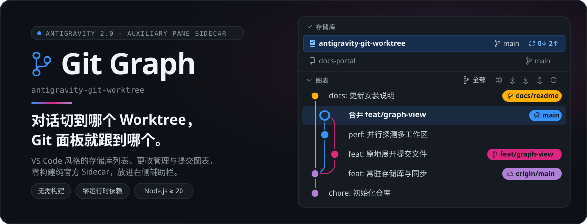
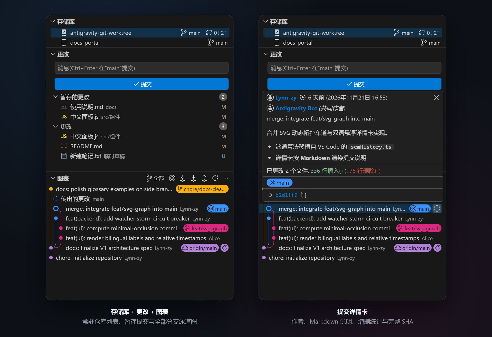
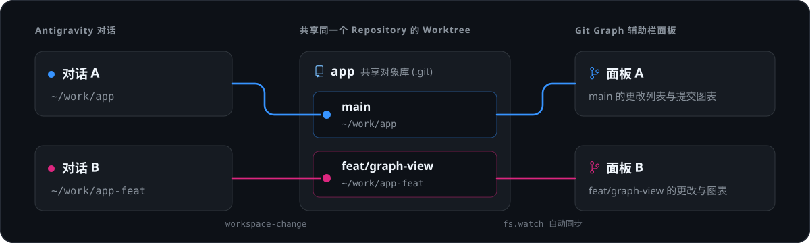
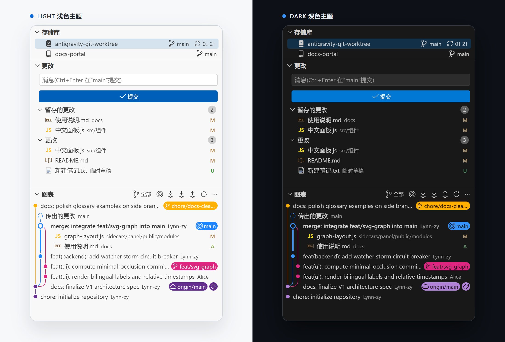

<div align="center">

<h1>Git Graph</h1>

<p>
  <strong>Antigravity 2.0 右侧辅助栏里的 VS Code 风格源代码管理与 SVG 提交图表。</strong><br/>
  当前对话在哪个 Worktree，面板就自动跟到哪个。无需构建，零运行时依赖。
</p>

<p>
  <a href="./README.md">English</a> · <strong>简体中文</strong>
</p>

<p>
  <a href="./plugin.json"></a>
  <a href="./sidecars/panel/package.json"></a>
  <a href="./docs/adr/0002-zero-build-esm-and-svg-graph.md"></a>
  <a href="./LICENSE"></a>
</p>



</div>

## 快速开始

**前置条件：** 安装 Node.js `>= 20`，并确保 `PATH` 中有可用的 `git`。

克隆仓库并运行对应平台的安装脚本：

```powershell
# Windows（PowerShell）
git clone https://github.com/Lynn-zy/antigravity-git-worktree.git
cd antigravity-git-worktree
powershell -ExecutionPolicy Bypass -File .\scripts\install.ps1
```

```bash
# macOS / Linux
git clone https://github.com/Lynn-zy/antigravity-git-worktree.git
cd antigravity-git-worktree
bash ./scripts/install.sh
```

脚本会把运行时文件复制到 `~/.gemini/config/plugins/antigravity-git-worktree`，不会修改 `~/.gemini/config/config.json`。安装后打开 Antigravity 的 **Customizations** 页面启用 **Git Graph**。更新或卸载运行中的插件时，脚本会读取 `.sidecar.pid` 自动重启或停止 Sidecar，不需要手动开关插件。

**想先在浏览器里体验？** 不打开 Antigravity 也能直接启动独立预览服务：

```bash
node sidecars/panel/main.mjs
# [antigravity-git-worktree] Standalone server listening at http://127.0.0.1:17892
```

访问 <http://127.0.0.1:17892/> 可直接查看当前真实仓库，访问 <http://127.0.0.1:17892/?fixture=mock&theme=dark> 则加载内置演示数据，暂存、提交和查看提交图表都在内存中完整运行。

<details>
<summary>安装脚本参数说明（拷贝安装、开发链接、卸载）</summary>

| 用途 | Windows | macOS / Linux |
| --- | --- | --- |
| 拷贝安装或更新运行文件（`plugin.json`、`assets/`、`sidecars/panel/`） | `.\scripts\install.ps1` | `bash ./scripts/install.sh` |
| 开发时让安装目录直接指向源码仓库 | `.\scripts\install.ps1 -Link`（Junction，无需管理员权限） | `bash ./scripts/install.sh --link`（符号链接） |
| 指定安装目录 | `.\scripts\install.ps1 -TargetDir <目录>` | `bash ./scripts/install.sh --target-dir <目录>` |
| 卸载（仅删除安装目录或链接本身，不触碰源码） | `.\scripts\install.ps1 -Uninstall` | `bash ./scripts/install.sh --uninstall` |

</details>

## 为什么选 Git Graph

同时开启多个 Antigravity 对话，且每个 Agent 在同一个 Repository 的不同 Worktree 上修改代码时，切去外部 IDE 或终端反复确认目录很容易打断节奏。Git Graph 固定在右侧 Auxiliary Pane 里，始终与当前对话打开的目录保持一致。

| 对比维度 | Git Graph（`antigravity-git-worktree`） | 另开 VS Code / Git 客户端 | 终端 `git` 命令 |
| --- | --- | --- | --- |
| 多 Worktree 对话切换 | 监听 `workspace-change` 自动跟随当前对话的 Worktree | 需要手动切换窗口或重新打开目录 | 需要手动 `cd` 到对应 Worktree |
| 宿主接入方式 | 仅使用官方 Sidecar SDK 与本地 `fs.watch`，无 CDP 注入 | 独立桌面窗口，游离于对话界面之外 | 独立终端标签页 |
| 安装与运行开销 | 0 个运行时依赖，无需编译构建（`Node.js >= 20` ESM） | 完整 IDE 或 Electron 进程 | 无额外依赖，但缺少图形化泳道 |
| 窄栏适配 | 面向 `320–560px` Auxiliary Pane 设计，无横向滚动条 | 面向宽屏桌面窗口设计 | 窄宽度下日志和路径易折行 |

<p align="center">
  
</p>

## 自动跟随当前对话的 Worktree

<p align="center">
  
</p>

- **免手动选仓库：** 插件监听宿主发出的 `workspace-change` 事件，并行探测各工作区目录，用 `git rev-parse --git-common-dir` 把共享同一对象库的多个 Worktree 归到同一个 Repository，并定位当前 Worktree。
- **文件系统自动同步：** 监听 `.git` 元数据与工作区文件变更。你在终端里执行任意 Git 命令，面板都会自动刷新。
- **常驻存储库列表：** 顶部常驻列出当前 Workspace 命中的所有 Repository、对应分支以及当前仓库的同步状态（例如 `0↓ 2↑`）。多仓库场景下点击行即可切换；点击同步状态可直接同步或发布分支，工作区里未提交的改动不受影响。

## 核心功能

### 更改（上半区）

- **状态自适应主按钮：** 输入提交说明后按 `Ctrl/Cmd + Enter` 提交。有已暂存文件时直接提交；只有未暂存更改时，确认后暂存全部再提交；工作区干净时，按 VS Code 顺序切换为「发布分支」或「同步更改（`N↓ M↑`）」。同步先执行 `git pull --ff-only`，之后仍领先上游再推送；本地与远端分叉时直接中止并提示到终端合并，不改动仓库。
- **分组暂存与安全确认：** 支持单文件或按分组暂存、取消暂存。放弃已跟踪更改和永久删除未跟踪文件之前都会弹窗确认。
- **大仓库防护：** 提交输入框固定在顶部，文件多时仅滚动文件列表。分组超过 `500` 行时启用可视区虚拟滚动；变更超过 `5000` 条时截断并只显示前 `5000` 条，文件监听触发的刷新至少间隔 `15` 秒。
- **进度反馈：** Git 操作执行期间在标题栏底边显示移动进度条，成功不弹打扰提示，失败才弹出错误提示。

### 提交图表（下半区）

- **VS Code 泳道布局：** 泳道算法移植自 VS Code 的 `scmHistory.ts`，配色与引用徽标归组规则一致。支持「自动」（当前分支及其上游）与「全部」（所有分支与标签）两种范围切换。
- **传出与传入的更改：** 领先上游时在 `HEAD` 上方显示「传出的更改」，落后上游时在合并基上方显示「传入的更改」，点击可展开相对合并基的改动文件列表。
- **紧凑顶栏操作：** 依次提供转到当前提交、提取（`git fetch --all --prune`）、拉取（`git pull --ff-only`）、推送、刷新，以及 `⋯` 菜单（提交搜索、全部折叠、中英文界面切换）。
- **原地展开与提交详情卡：** 点击提交行原地展开改动的全部文件。点击行尾详情按钮打开最小遮挡提交详情卡，包含作者与共同作者、相对与绝对时间、Markdown 渲染的提交说明、增删行数统计、引用胶囊和一键复制完整 SHA。

### 明暗主题与原生文件打开

<p align="center">
  
</p>

- **跟随宿主主题：** 颜色取自宿主注入的 CSS 变量，配合 1×1 Canvas 亮度检测自动同步浅色、深色与高对比度主题。成功、警告、错误三种状态色自动校正到与背景至少 `4.5:1` 的对比度。
- **宿主原生打开文件：** 点击更改区或提交里的文件，统一调用宿主 `fileView` 在辅助栏中打开。文件与文件夹图标来自 `vscode-icons`。

## 浏览器独立预览与环境变量

未注入 `ANTIGRAVITY_SIDECAR_WEB_PORT` 时，`sidecars/panel/main.mjs` 会在 `127.0.0.1:17892` 启动本地 HTTP 服务：

```bash
# 显示当前仓库，或传入一个或多个仓库目录
node sidecars/panel/main.mjs
node sidecars/panel/main.mjs /path/to/repo-a /path/to/repo-b
```

| URL 参数 | 说明 |
| --- | --- |
| `fixture=mock` | 使用内置内存演示数据（`antigravity-git-worktree` 与 `docs-portal`） |
| `theme=dark`、`theme=light` | 在独立预览模式中指定深色或浅色主题 |
| `sdk=1` | 注入模拟的 `window.sidecar`，用于调试 `theme-change` 与 `workspace-change` 消息 |

| 环境变量 | 说明 |
| --- | --- |
| `AG_GIT_PORT` | 独立预览服务端口，默认 `17892` |
| `AG_GIT_PATHS` | 指定显示的仓库目录（Windows 用 `;` 分隔，macOS / Linux 用 `:` 分隔） |
| `AG_GIT_FIXTURE` | 设为 `mock` 时默认返回内置演示数据 |
| `AG_BROWSER_PATH` | 浏览器端到端测试中显式指定 `msedge.exe` 或 `chrome` 路径 |

## 刻意不做的事

为了保持窄幅辅助栏的轻量与稳定，当前 V1 版本明确不包含以下能力（完整清单见 [docs/spec.md](./docs/spec.md#13-明确不在-v1-范围)）：

- **Worktree 与分支切换：** 不负责新建、锁定、删除 Worktree 或切换分支。Worktree 和对话切换由 Antigravity 宿主承担，切换分支请使用终端或 IDE。
- **内建 Diff 查看器：** 查看文件统一交给宿主原生 `fileView`。
- **复杂历史改写操作：** 不支持行级或 Hunk 级暂存、Stash、Rebase、`--amend` 和 Force Push。需要这些操作时请直接使用终端 Git CLI。
- **CDP 或非公开宿主注入：** 不连接 `DevToolsActivePort`，不修改宿主渲染进程（见 [ADR 0001](./docs/adr/0001-pure-official-sidecar-and-scope-focus.md)）。

## 项目状态与开发

**当前状态：** `v0.1.0`，积极维护中。V1 架构规格定义的全部能力已实现，包含单元测试、真实多仓库后端集成测试与无头浏览器端到端测试。

<details>
<summary>运行测试（无需 npm install）</summary>

全部测试使用 Node.js 内置 `node:test`。浏览器端到端测试需要 Node.js `>= 22`（使用内置 `WebSocket` 与 `fetch`）以及本机安装的 Microsoft Edge 或 Google Chrome。

```bash
# 运行全部三层测试：单元测试、集成测试与无头浏览器端到端测试
node --test tests/unit/*.test.mjs tests/integration/*.test.mjs tests/browser/*.test.mjs

# 按层单独运行
node --test tests/unit/*.test.mjs
node --test tests/integration/*.test.mjs
node --test tests/browser/m5-e2e-browser.test.mjs
```

</details>

<details>
<summary>重新生成图标数据</summary>

`codicons.js`、`file-icon-map.js` 与 `sidecars/panel/public/file-icons/` 下的 SVG 均由脚本从固定提交的上游仓库生成，请勿手改。升级上游时，修改脚本顶部的提交 SHA 后重新执行：

```bash
# 需要 Node.js 22.18+、git、tar 与 GitHub 网络访问
node scripts/gen-codicons.mjs
node scripts/gen-file-icons.mjs
```

</details>

**项目文档：** [V1 架构规格](./docs/spec.md) · [领域词汇表](./GLOSSARY.md) · [架构决策记录](./docs/adr/) · [协作约定](./AGENTS.md)

## 许可证与第三方声明

本项目采用 [MIT 许可证](./LICENSE) 开源。

泳道布局算法移植自 Visual Studio Code，图标来自 VS Code Codicons 与 vscode-icons，完整归属与许可证全文见 [THIRD_PARTY_NOTICES.md](./THIRD_PARTY_NOTICES.md)。
